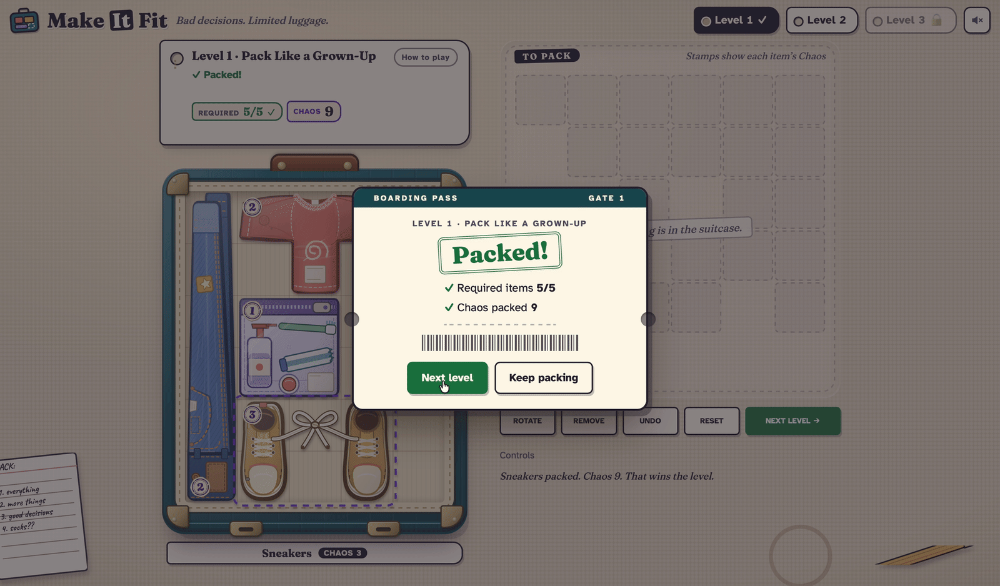
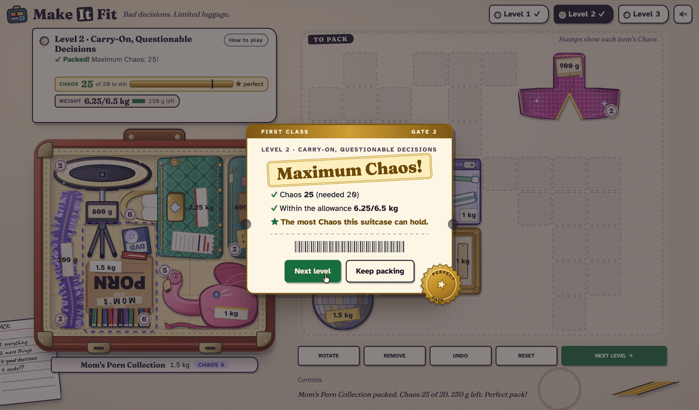
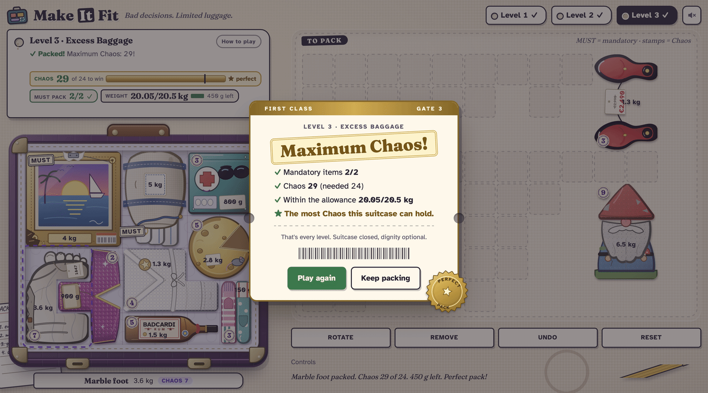

# Make It Fit

**Bad decisions. Limited luggage.**

A browser puzzle game about packing an open suitcase for a trip you should not be taking. Drag and rotate belongings onto a grid, stay under the weight allowance, and collect enough **Chaos** to win. The items are the joke: a marble foot, a garden gnome, a flamingo, a hotel painting that has to come along. Three hand-made levels, no timer, no account, no server.

**[Play it: make-it-fit.pages.dev](https://make-it-fit.pages.dev/)** · [40-second video](assets/demo/make-it-fit-demo.mp4) (silent MP4)

| Level 1 · packed | Level 2 · perfect pack | Level 3 · maximum Chaos |
|---|---|---|
| [](assets/demo/level-1-packed.png) | [](assets/demo/level-2-perfect.png) | [](assets/demo/level-3-maximum-chaos.png) |

Captured from the live site. Built with React 19, TypeScript, Vite, a Python puzzle solver, Vitest, Playwright and GitHub Actions. All artwork is original SVG drawn in code.

## What makes it interesting

- **Every puzzle is proven by an exhaustive solver.** `verify_levels.py` (Python, standard library only) tries every combination of items and shows each level is solvable. Level 3, for example, has 532 legal packs, 37 that win and exactly one perfect combination. The level data and solution fixtures are generated from it, and CI fails if they drift.
- **The rules are a pure TypeScript engine** with no React or DOM in it: shapes, rotation, collision, undo, weight and win checks. It is tested headlessly and replays the solver's answers as a cross-check between two implementations.
- **Dragging is tuned for WebKit.** Pointer input is applied once per animation frame and React re-renders only when the snapped target cell changes. Browser tests measure React commits and frame time during a drag on Chrome and Playwright's WebKit engine.
- **Saved data is treated as untrusted.** Progress and arrangements are versioned, validated and replayed through the engine, so a corrupt or outdated save cannot put an invalid board on screen.
- **Built to be playable without a mouse.** Every action works from the keyboard, score and weight changes are announced through live regions, focus is always visible, and `prefers-reduced-motion` is respected. This is a good-faith implementation, not an audited or certified one (see Limitations).
- **Sound without assets.** Effects are synthesised with the Web Audio API: no audio files, off until the player turns it on, and nothing depends on hearing it.

## How it plays

Every item is a set of grid cells, so collision and rotation are exact. Drag items onto the suitcase (rotate in 90° steps); an item fits only if all its cells are on the board and none overlap. Each item shows its weight and a stamped **Chaos** value. You win when the total weight is within the allowance and the Chaos target is met. Undo and reset are unlimited, and progress is saved in the browser only.

- **Level 1** (5×6): pack all five items. There is no allowance, and the solver shows it cannot be done without rotating.
- **Level 2** (6×5, 6.5 kg): choose from ten items and reach 20 Chaos. A perfect pack reaches 25.
- **Level 3** (7×6, 20.5 kg): the painting and the laundry bag must come; choose from ten more and reach 24 Chaos. A perfect pack reaches 29.

Each target is 80% of the level's perfect score, rounded up. The game never says which combination is perfect.

Controls: drag with a mouse or finger, or use `Tab` to an item, `Enter` to pick up, arrows to move, `Enter` to place. `R` rotates, `Esc` cancels a move, `Delete` removes an item, and `Ctrl`/`⌘` + `Z` undoes. First-time visitors see a short start screen; `?intro` replays it.

## Architecture

```
VERIFIED_LEVELS.json ──► src/engine (pure rules) ──► LevelPlay.tsx (drag, keyboard, dialogs) ──► App.tsx (levels, progress)
        ▲                                                                                              │
verify_levels.py (solver)                                                                  localStorage (validated)
```

A static single-page app with no network requests after load. `App` owns the open level, saved progress and arrangements; `LevelPlay` owns the live state of one level; `src/ui` holds pointer and layout maths; `src/status.ts` holds every sentence the game announces. Tradeoffs, including why `LevelPlay.tsx` is large on purpose and why the linter is Oxlint rather than ESLint, are in [docs/ARCHITECTURE.md](docs/ARCHITECTURE.md).

## Verification

- **Static checks:** `tsc -b` and Oxlint (`--deny-warnings`), both clean.
- **Unit tests:** 239 Vitest tests in 22 files covering the engine, solver fixtures, persistence, layout and drag maths, announcements, the sound system (against a mocked audio context) and the licence.
- **Solver:** `verify_levels.py` reproduces the committed puzzle data and fixtures exactly.
- **Browser tests:** Playwright drives real drags, rotation, keyboard play, progression, persistence and the opening at phone, tablet and desktop sizes (320 to 1280 px) on Chrome, Playwright's WebKit and a Firefox subset, against both the dev server and the production build. They include the suitcase staying still when a level is solved, and text enlarged to 200% (simulated by scaling the root font size).
- **Production build:** `npm run check:prod-clean` fails if dev tools or solution data reach `dist`, and a test runs the game under the shipped Content-Security-Policy with no violations.

[`.github/workflows/ci.yml`](.github/workflows/ci.yml) runs all of this on every pull request as six parallel jobs: static checks, Chrome (two shards), WebKit (two shards) and Firefox. Timing-sensitive checks run alone on one worker so a busy runner cannot distort them.

## Run it locally

Node.js 24 (what CI uses) and Python 3.

```bash
npm ci
npm run dev            # dev server; includes a dev-only panel for jumping between levels
npm run build          # production build into dist/
```

To run the checks:

```bash
npx tsc -b
npm run lint
npm test                      # Vitest
python3 verify_levels.py      # solver; then `git diff --exit-code` on the generated files
npm run check:prod-clean
npx playwright install chrome webkit firefox   # once
PW_FIREFOX=1 npm run test:e2e
```

The browser tests use your installed Google Chrome plus Playwright's WebKit and Firefox builds, and start their own servers on ports 5180 and 5181.

## Limitations

- The author has played the game on a real iPhone, but there is no recorded device test. Desktop Safari, Safari's text-size setting and VoiceOver have not been tested, and the WebKit tests use Playwright's engine, which is not Safari itself. The accessibility features above have not had a formal audit.
- Three levels. Progress lives in one browser: there are no accounts or sync.
- Adding a level means running the solver and regenerating its data. Item shapes and layouts are tuned for the shipped levels.
- Chaos values and difficulty are design choices, not measurements, and have had no formal playtesting.
- Hosted as a static site on Cloudflare Pages. The GitHub Actions workflow only checks the code; it does not deploy.

## Where to look in the code

- Rules: `src/engine/` (`shape.ts`, `game.ts`); cross-checks in `engine.test.ts` and `enumerate.test.ts`.
- Solver: `verify_levels.py`, specification in `LEVEL_DESIGN.md`.
- Drag and keyboard interaction: `src/LevelPlay.tsx`, `src/ui/`; measured by `e2e/drag-performance.spec.ts`.
- Persistence: `src/progress.ts`, `src/boards.ts`.
- Opening: `src/useOpening.ts`, `e2e/opening.spec.ts`.
- Production checks: `e2e/prod.spec.ts`, `public/_headers`.
- Architecture notes: [`docs/ARCHITECTURE.md`](docs/ARCHITECTURE.md).

## Licence

Source-available, not open source. Copyright (c) 2026 Nova Zandkarimi, all rights reserved. You may read the code, play the game, and clone and run a private copy to evaluate it; no permission is given to redistribute, host or modify and distribute it, or to use it commercially. See [`LICENSE`](LICENSE) for the exact terms, which preserve your rights under applicable law and GitHub's terms (including forking on GitHub). Third-party components keep their own licences: React (MIT) and three fonts (SIL OFL 1.1), listed in [`public/third-party-notices.txt`](public/third-party-notices.txt).
