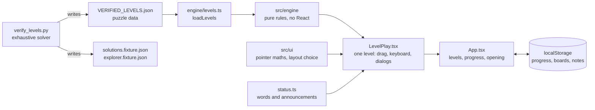

# Architecture

A short tour of how Make It Fit is put together and why. Everything below can be checked in the code; the file names are given so it can be.

## Shape of the system

Static single-page app (React 19, TypeScript, Vite). No server, no network requests after load.

## The puzzle engine (`src/engine`)

Pure TypeScript with no React or DOM imports, so it is tested without a browser.

- **Shapes.** An item is a set of grid cells. `normalize` moves a shape to a (0,0) corner and sorts it; `rotateOnce` maps (x, y) to (y, -x) and re-normalizes; `rotate(shape, n)` applies n quarter turns. `uniqueRotations` lists the distinct orientations (a square has one, an L has four). (`shape.ts`)
- **Placement rules.** `validatePlacement` has exactly two failure modes besides unknown items: a cell outside the board (`out-of-bounds`) and a cell another item already covers (`overlap`). Weight is deliberately not a placement rule: placing over the allowance is allowed and shown, and completion requires the total to be within it. (`game.ts`)
- **State is immutable.** `GameState` holds the level, the current placements and the earlier placement lists for undo. Every action returns a new state or a typed error (`ActionResult`); nothing mutates. (`game.ts`, `types.ts`)
- **Winning.** `isWon`: every required item is placed, weight is within the allowance, and on levels with a Chaos target the target is reached. `isPerfect`: a win that also reaches the level's maximum Chaos. Level 1 shows Chaos numbers but has no target, so it is won by packing everything.
- **Interaction helpers** (`interaction.ts`) such as `previewPlacement` and `clampOrigin` answer "would this fit there?" for the drag preview without changing state.

## Verifying the puzzle data

`VERIFIED_LEVELS.json` is generated, not hand-edited. `verify_levels.py` is an exhaustive search written in Python (a different language and code base from the engine, which re-implements the same rules): it decides whether each level is solvable, which item sets fit, and the maximum Chaos. It writes the level data and two fixtures, `src/engine/solutions.fixture.json` (reference solutions) and `src/dev/explorer.fixture.json` (every passing and perfect set, for the developer Solution Explorer).

Three layers keep these honest:

1. **CI fails on drift.** It re-runs the solver and `git diff --exit-code`s the three generated files.
2. **The engine accepts the solver's answers.** `engine.test.ts` replays the fixture solutions through the TypeScript engine and checks that every layout is a win, in bounds and overlap-free, that a normal win reaches the target without being perfect, and that the perfect layout reaches the maximum.
3. **A second derivation in TypeScript.** `enumerate.test.ts` re-derives which item subsets fit and weigh within the allowance. It reuses the engine's own shape and rotation code, so it independently checks the search and the data, not the rotation maths themselves.

## State ownership

| Where | Owns |
|---|---|
| `App.tsx` | which level is open, saved progress, saved arrangements, which how-to notes were seen, the dev-only test session, the opening (via `useOpening.ts`) |
| `LevelPlay.tsx` | the live game state for one level, the item being carried, selection, hover and focus, the win dialogs, undo and reset, screen-reader messages |
| `src/ui` | pure layout and pointer maths (`fit.ts` picks the arrangement and cell size for a viewport; `drag.ts` and `geometry.ts` turn a pointer position into a board cell) |
| `src/status.ts` | the sentences the game shows and announces (score line, weight left, "still to pack", item summaries) as pure functions |

`LevelPlay` is keyed by level id, so changing level remounts it with that level's saved arrangement. It reports changes upward (`onBoardChange`, `onWin`); `App` writes progress, arrangements and notes to storage (`useOpening` writes only its session flag).

**The drag pipeline.** Pointer position is kept in refs and applied once per animation frame; React state changes only when the snapped target cell or a flag changes, not on every pointer move. The window-level move, up and key handlers live in a ref and are attached once for the life of the component, so they always see the latest state without being re-attached. This exists because drag rendering was a real problem on WebKit; `e2e/drag-performance.spec.ts` measures React commits and frame time during a drag on Chrome and Playwright's WebKit engine (a development-only counter, compiled out of production builds).

## Persistence and progression

All storage is the visitor's own browser; every key is versioned and every read is validated, because stored JSON is untrusted input.

| Key | Storage | Content |
|---|---|---|
| `make-it-fit:progress:v1` | localStorage | completed levels, best Chaos, perfect flag (payload `version: 2`; version 1 saves migrate) — `progress.ts` |
| `make-it-fit:boards:v1` | localStorage | the arrangement left in each level, with a signature of the level it was made for — `boards.ts` |
| `make-it-fit:intro:v1` | localStorage | which how-to-play notes were seen — `intro.ts` |
| `make-it-fit:sound:v1` | localStorage | whether sound is muted (`{version: 1, muted}`; anything else reads as the default, muted) — `soundPref.ts` |
| `make-it-fit:opening:v1` | sessionStorage | the opening's Play was pressed in this browsing session — `useOpening.ts` |

- **A saved board is a starting point, not truth.** `restoreGame` replays the saved placements through the engine; if the level's signature changed (`levelSignature` covers board size, allowance, targets, items, shapes, weights, Chaos and required flags) or any placement is now illegal, the level starts empty. A corrupt or outdated save cannot put an invalid layout on screen.
- **Progression.** A level is playable when it is first or the one before it is completed (`isUnlocked`). `recordCompletion` keeps the best Chaos and never un-completes a level.
- **Failure is quiet.** Missing or blocked storage (private mode) falls back to in-memory state; the game still plays.
- **Developer test mode** (development builds only) keeps its wins and boards in memory and never writes storage.

## The opening

`useOpening.ts` decides whether to show it (`shouldPlayOpening`: new player, once per session, not under automation, `?intro` forces it), measures where the wordmark starts (`openingLayout`), and sequences Play. The wordmark is drawn at its large size with CSS `zoom` and shrunk into place by a transform, so text stays sharp; a fixed-size slot keeps the masthead's layout from shifting. While it is up the game underneath is `inert`. Reduced motion shows it without movement and Play enters immediately. All motion is CSS in `styles.css` (transform and opacity).

## Sound

`sound.ts` synthesises seven short effects (pick up, put back, place, rotate, invalid, complete, perfect) with the Web Audio API: no audio files, no music, no requests. It is a single module-level object outside React; `LevelPlay` calls `sound.play(event)` where the action's outcome is known (a drag begins, `commitCarry` succeeds or fails, a rotation happens, the win is first celebrated), so a sound is never played for a pointer event that did nothing.

- **Palette.** Picking up is a very short, dull touch of filtered noise with one faint low tone, and placing is a soft landing with one warm low tone that does not fall (no sweep, no chord, nothing bright). Rotation is two small ticks, taking an item out is a soft falling breath, and invalid is two soft falling notes; these three pass a 400 Hz high-pass and an 8 kHz low-pass. The two rewards are short melodies of triangle and sine tones (completion four notes, perfect pack five, climbing higher). History: an early version put a falling 147 Hz sine under every placement, which sounded like a kick drum; a later bell-and-breath version was judged worse than the first rewards, so the reward melodies are the original ones.
- **Off by default.** `DEFAULT_MUTED` is true: no audio context exists until the player presses the masthead speaker button once (`aria-pressed`, label "Sound effects"). The choice is saved separately from progress and respected on later visits; a damaged saved value reads as muted.
- The `AudioContext` is created lazily, from a player action, and never while muted. A suspended context is resumed, and a sound that would arrive late is dropped rather than played delayed. Each sound has a minimum gap, so a held key or fast tap cannot stack it. Missing Web Audio, a context that fails to start and a voice that throws are all swallowed: audio never blocks or breaks play.
- Tests replace `AudioContext` with a recorder (`sound.test.ts`, `e2e/sound.spec.ts`); they check which tones start, not what is audible. How it sounds is judged by listening.

## Test layers

| Layer | Where | Proves |
|---|---|---|
| Unit | `src/**/*.test.ts(x)`, Vitest | engine rules, solver fixtures, persistence parsing and migration, layout and drag maths, announcements, art markup, third-party notices |
| Puzzle data | `verify_levels.py` + CI diff | the committed levels and fixtures are exactly what the solver derives |
| Browser (dev server) | `e2e/*.spec.ts`, Playwright on Chrome | real drags, rotation, keyboard play, screen-reader messages, progression and persistence, layout at phone, tablet and desktop sizes, the opening |
| Browser (WebKit, Firefox) | the same specs where they apply | Playwright's WebKit engine (not Safari itself) for drag and layout; a Firefox smoke subset |
| Production build | `e2e/prod.spec.ts`, `npm run check:prod-clean` | no developer tools or solution data in `dist`, relative asset paths, the shipped Content-Security-Policy runs the game with no violations |
| Static analysis | `npm run lint` (Oxlint), `tsc -b` | hook rules, no `any` or stray `console`, strict types |

What is not covered: real Safari and physical-device behaviour are manual checks.

## Tradeoffs worth knowing

- **Grid cells, not geometry.** Items are cell sets, so collision, rotation and snapping are exact and cheap to test; the cost is that items cannot be free-form.
- **Weight is advisory while packing.** Allowing an over-limit pack, and explaining it, plays better than refusing the drop; the engine rule is "complete only when within the allowance".
- **Art is SVG in code.** No image assets to license or load, and illustrations scale with the board; the cost is large art modules (`src/art`).
- **`LevelPlay.tsx` is large on purpose.** The drag pipeline's refs, handlers and effects are coupled by design (they are what keeps dragging smooth on WebKit); splitting them apart would add indirection without making them independently testable. The testable text and rules were moved out into `status.ts` and `src/engine` instead.
- **Linting uses Oxlint, not ESLint.** typescript-eslint's peer range stops below TypeScript 7 (the version used here), so the usual ESLint stack cannot parse the project; Oxlint parses TypeScript itself.
